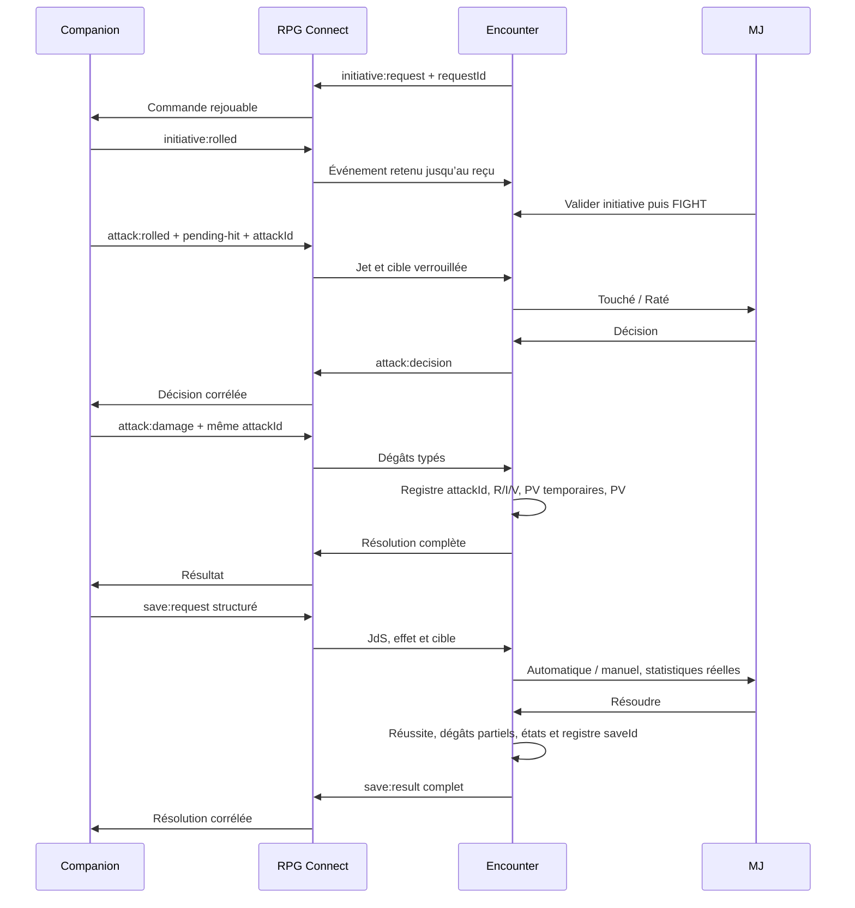

# Audit de compatibilité — 4 octobre 2026

État initial figé avant toute correction. La cohérence statique ne constitue pas une validation E2E.

| Dépôt | Ref | Commit | Client SHA256 | Serveur SHA256 |
|---|---|---|---|---|
| Brackmard | origin/main | 1b7fd8d52daa9d77e4b0c30c5e7d5f6ab4b0a51a | cc9e25d92d57 | — |
| Brackmard | origin/baseline-2026-10-03-2330 | d603d049d0d21334fbe553ccf1268632d0d153ee | f87fa1af7a30 | — |
| Brackmard | origin/backup-before-rollback-2026-10-04-2243 | 3e9f90f51d197a3e177abda0d8b3ea3e60c2e9b0 | 298d692449c8 | — |
| Encounter | origin/main | 87867998680785c54a0546f95459c39733cf371f | — | aa4f5473ba20 |
| Encounter | origin/baseline-2026-10-03-2330 | 81d84e8ee45c0c4beb3d06224887762871c83340 | — | aa4f5473ba20 |
| Encounter | origin/backup-before-rollback-2026-10-04-2243 | f53f4b014db5725c4af21040896e3584a70f7025 | — | ab0f8a1805c5 |
| Kentaro | origin/main | cdbe8fae1d7e925fc33300dab03a0f70f7c1867b | 339e0ad4f4a0 | — |
| Kentaro | origin/baseline-2026-10-03-2330 | 63d2cb812ac60706a1ef3d941626cd6cd47d03e3 | 6f6451c49e39 | — |
| Kentaro | origin/backup-before-rollback-2026-10-04-2243 | 70b9c98af0f6b932c64650955020c4d0d29204ee | e7f6a4b7bcc5 | — |
| Nans | origin/main | d05dd0273f4b4dc5e3d33d68437005a8434ea419 | cc9e25d92d57 | — |
| Nans | origin/backup-before-rollback-2026-10-04-2243 | 3ccbd17605a352956179c6e4677faa1a954f60b9 | 298d692449c8 | — |
| Pik | origin/main | 4fd9a6cd53d1efc39d4c4a550170aad85c3a9397 | — | — |
| RPG-Connect | origin/main | ba640794c73df8ee2067375e09d73446f378482a | — | — |
| Rufus | origin/main | e515e1d94bb2624fd2cdf9370860c6247e10cf08 | 54017dc7add2 | — |
| Rufus | origin/baseline-2026-10-03-2330 | a623cce525b505f96a60b91e2b14df3506e0a30b | 6e7e612b5a5b | — |
| Rufus | origin/backup-before-rollback-2026-10-04-2243 | 1465cec1f6bf83304627ac085d849865b4c401e5 | bdc3b423cb8e | — |
| Samoth | origin/main | 6494771c4a294fcba70ff0d3b8be7056a19310d5 | cc9e25d92d57 | — |
| Samoth | origin/baseline-2026-10-03-2330 | 075526e479071ff28e7403d458a707ffd62d59a7 | f87fa1af7a30 | — |
| Samoth | origin/backup-before-rollback-2026-10-04-2243 | 254deea46a558eb2508e31c1747d31e877a0516e | 2367af72a920 | — |
| Silas | origin/main | f33fd9fd08db4ccb74eb3c692df308064d313aa3 | — | — |
| Wonq | origin/main | 2da7a9d32510c9f33fb89a1a7c2bf62bd08774a8 | — | — |
| Zephyr | origin/main | a3a35bd61aa239686859007391982e7810d7fa1c | cc9e25d92d57 | — |
| Zephyr | origin/baseline-2026-10-03-2330 | 6de44d13efcf70d6b74dd800b628738a19ec3259 | f87fa1af7a30 | — |
| Zephyr | origin/backup-before-rollback-2026-10-04-2243 | 13fb3885bf46bca9038caaeb9906ed6071630b60 | 298d692449c8 | — |

## Ensembles candidats

- Baseline temporelle : refs baseline-2026-10-03-2330 ; Nans ec66a6b (même minute). Dernier ensemble réputé fonctionnel par l’utilisateur, à vérifier dans Chromium.
- Main figé : baseline + ordre Prépa, ACK initiative, CSS et suppression HUD ; même API locale dans les six compagnons.
- Sauvegarde : clients et serveur différents ; JdS composés, état/concentration et corrections multiples. À utiliser pour comprendre les intentions, sans cherry-pick massif.
- Wonq, Pik, Silas : références seulement ; aucun client RPG Connect local constaté dans ces trois dépôts.

## Constats statiques initiaux

- Le serveur est dans Encounter ; RPG-Connect contient les assets/registre.
- Contrat transport v:1, sans capabilities ni négociation de version applicative.
- CI Encounter clone main des compagnons au lieu de refs figées : résultat non reproductible.
- CI Kentaro exige blade(sun,bonus) alors que le chemin existant a un troisième argument third.
- Baseline JdS : résolution automatique immédiate, sans choix MJ ; ne satisfait pas le scénario demandé.
- Dédoublonnage des dégâts par event.id, pas par transaction attackId : unicité métier à vérifier.
- prepareFight appelle plusieurs opérations UI/binding avant initiative:request ; risque de blocage subsistant.

La matrice ci-dessus a été enregistrée avant les corrections. Aucune fusion ni modification de main pendant la mission.

## Résultat de l’audit et ensemble retenu

La baseline du 3 octobre est le dernier ensemble temporel coordonné identifiable, **pas un ensemble certifié** : les pages Kentaro/Brack de cette baseline produisent une erreur de syntaxe dans l’ancien HUD inline. Les main figés passent l’initiative et les attaques ordinaires en contexte neuf, mais échouent à l’unicité métier des dégâts et n’offrent pas le JdS MJ demandé. Aucun ensemble historique testé ne satisfait tous les critères. L’ensemble cohérent retenu est donc celui reconstruit sur les main rollbackés, dont les commits exacts sont figés ci-dessous. Les sauvegardes ont servi de documentation fonctionnelle ; aucun cherry-pick massif.

| Dépôt | Commit de staging des sources | Arbre Git vérifié |
|---|---|---|
| Kentaro | `089e2423d5718d35d4c52437f58f7c1599b3196c` | `8b91fb48d3a33d68059714dc1e4aa810248f7ea1` |
| Brackmard | `6ca4d52f7d009473f4a93e44381e5ce0dda0dbb4` | `47f8ee77b13b3db4add777bd18d8b3cbd7786c09` |
| Zephyr | `0a53015c336ae8396945f81b792d2ca701e647ab` | `06bd551c1df50ecc9dd01567b88ecb5e2a72b184` |
| Rufus | `8162494dd5e7ed1380da369d124f04293db3c947` | `12c783afa5d10d21827c404f47457cfa49d525da` |
| Samoth | `3125d037b233b816732be5cd538bdc6a89afca3f` | `887a8318a47c5cf5ff6dd0b2316a2e3f9ccd6aa6` |
| Nans | `f4847b126d836c71b9b6cad899773a5d7b5115e6` | `44b96a46316c6eb5c8b1518f5c0380b6e0281ba3` |
| Encounter | `634b988680ee2964a5c98806cd1360f4252a00c7` | `158c8befe16f668d4ab00e164c19ce49f18bfa92` |
| RPG-Connect | `6104f8bdd6f64df1aa7be597f7166d454a510fe7` | `3a8d45afc538767a05ed7bc55d9bc9a9889135cf` |

La révision Encounter du tableau fige les sources applicatives. Les commits suivants de la même branche ajoutent les outils CI, les preuves et ce rapport. La CI vérifie Encounter à son propre commit et télécharge chaque Companion et RPG-Connect au SHA immuable du manifest, sans cloner main. Les arbres publiés ont été comparés aux arbres locaux testés. `evidence/main-unchanged.json` enregistre les onze main restés inchangés.

## Causes racines, avec niveau de preuve

| Cause | Preuve | Correction |
|---|---|---|
| Déduplication par event.id seulement | Même attackId, nouvel event.id : PV 947→935 une deuxième fois dans la version figée | Décision MJ obligatoire, propriétaire et cible verrouillés, registre persistant `rpgAppliedAttacks` par attackId |
| Effets secondaires avant initiative | Injection d’erreurs dans render/saveState ; ancienne structure pouvait interrompre la séquence | Envoi direct du lot initiative:request avant les opérations secondaires ; celles-ci sont isolées |
| Modale prisonnière d’un stacking context | Baseline contient HUD inline concurrent ; inventaire CSS et DOM calculé | Dialog natif dans body, top layer ; une seule racine `.rpg-connect`, aucun ancien HUD réintroduit |
| Réactions de Brack hors transport | Pas d’incrément de dommages observable ; critique local contournait MJ ; bonus verrouillé en aria-disabled | Émission explicite corrélée, validation MJ des critiques, rafraîchissement de l’économie après décision distante |
| JdS résolus sans MJ ou inférés du journal | Baseline résout automatiquement ; observateur texte fragile | Requêtes structurées depuis les mécanismes natifs, file de décisions MJ explicites |
| Echo d’état périmé | Relecture d’un ancien HP et d’un état supprimé | epoch/revision séparées pour état local et conditions Encounter, origine locale/concentration conservée |
| ACK du bus malgré absence du MJ | Événement joueur perdu lorsque le MJ n’est pas connecté | File serveur jusqu’à event-ack du MJ, retransmission Companion jusqu’à ACK du bus |
| Compatibilité implicite | v:1 sans capacités ; ancien client accepté | Hello obligatoire avec protocolVersion et clientCapabilities, welcome/health avec capacités, refus explicite et arrêt des retries |
| CI dépendante de main et regex trop étroite | Test bonus cherchait deux arguments ; branches variables | SHA figés et regex acceptant le troisième argument third |
| Cycle backend couplé au dépôt UI | rpg-connect-server.js et package de backend résident dans Encounter | Architecture de séparation proposée ci-dessous ; configuration Render de production non modifiée |

L’ordre de Prépa est : déterminer le roster → lancer les demandes d’initiative pour tous → synchronisations et rendu optionnels. Le journal, target:clear, concentration, états, state:sync et persistence ne conditionnent plus l’émission du lot. La concentration structurée de Rufus est normalisée en nom de sort avant transmission ; le test observe Motif hypnotique dans Encounter et exclut l’affichage [object Object].

Les mutations API rafraîchissent aussi la disponibilité des boutons natifs : le blocage après changement de tour distant a été reproduit sur Nans et corrigé dans la passerelle commune.

Un problème avant la constitution du roster reste une erreur de précondition, distincte d’un effet secondaire.

## Flux autoritaire

Le Companion décide des ressources, de l’économie locale et des dés du personnage. Encounter décide du résultat de combat et des changements réels des cibles. Les effets de manœuvre/châtiment associés à une attaque héritent de son attackId et de sa cible verrouillée ; Encounter refuse un JdS issu d’une attaque non approuvée. Les journaux servent à l’affichage, jamais de bus d’événements.

## Fonctionnalités réintégrées

| Famille | Mise en œuvre | Preuve |
|---|---|---|
| Initiative et HUD | Dialog natif top layer, un seul HUD, ACK après clic réel | hidden, computed styles, bounding rect et elementFromPoint ; HUD injecté z-index 2147483647 |
| Attaques Brack | Principale, bonus Cogneur lourd, opportunité, Sentinelle, Riposte ; dégâts contondants/feu corrélés | Tests natifs Chromium, décision MJ et même attackId |
| Kentaro bonus | Chemins existants blade(sun/moon,bonus,third) conservés ; CI corrigée | Deux attaques principales puis Solinar bonus ; ressource bonus consommée |
| JdS | Module Encounter autonome de décisions, automatique/manuelle, modificateurs réels, avantages/désavantages, auto-échecs, immunités, effets composés | Tests natifs des six personnages ; test composite froid/feu/radiants avec R/I/V et absorption temp HP |
| États | Icônes partagées, deux visibles en vue rapide, surplus compté ; personnages, adversaires, PNJ et alliés pris en charge | Deux états réellement affichés ; synchronisation et suppression, rejeu ancien rejeté |
| Origines locales | États locaux séparés des conditions reçues ; concentration remontée/supprimée | Voile spirituel local observé dans Encounter puis retiré |
| PV | Module POINTS DE VIE et PV temporaires intégré à l’ancienne table | Contrôle UI des PV temporaires actionné ; dégâts absorbent les temporaires en premier |
| Couleurs/repos | Rouge dégâts, vert soins, thème information, gris neutre ; confirmations de repos natives | Six rubans réellement testés ; annulation de repos conserve les PV |
| Icônes | Registre canonique RPG-Connect et distributions identiques | 4 tests d’icônes ; assets locaux servis en E2E, URL de production figée |
| Design Encounter | Ancienne table conservée, bouton Préparation, Companion vert, PJ bleu, adversaire rouge, boss halo animé, PNJ allié jaune | Modifications limitées aux classes de rôle/états/PV ; respect reduced-motion |
| Kentaro mobile | Header repris de l’intention 482d3ae ; huit images exactes b2b5d5c | Viewports 390/768 ; inspection visuelle de l’icône centrée |
| Transport | ACK joueur, reçu MJ, backlog de déconnexion, capacités explicites | Tests WebSocket réels, reconnexion et message UI d’incompatibilité |

### Routage natif conservé

| Personnage | Entrées structurées |
|---|---|
| Kentaro | castSpellButton, castSynapticStatic, JdS des lames |
| Brack | manœuvres Croc-en-jambe/Menaçante/Poussée, Souffle de la forge |
| Zéphyr | Peur, Malédiction, Représailles, châtiments, Présence conquérante, BINAH |
| Samoth | cast/sendEncounterSave, Vortex de glace, sorts et pouvoirs du dragon/bâton |
| Rufus | castHex, pouvoirs du Linceul et attaques à JdS ciblé |
| Nans | hornPower et Présence intimidante |

Wonq, Pik et Silas ne sont pas écrasés : aucune branche corrective ni changement de source. Leurs passes de couleurs/repos servent de référence, mais leurs moteurs et contrats restent distincts. Aucun client RPG Connect local n’a été constaté dans leurs versions initiales.

## Tests et reproduction

**77 contrôles E2E verts, 16 tests automatisés verts, aucune erreur JavaScript de page.** Les confirmations de repos court ET long sont testées chez les six personnages. Manœuvre Brack, sorts/châtiment/conquête Zéphyr et cor/peur Nans sont déclenchés par leurs handlers natifs.

Le serveur lancé est le vrai rpg-connect-server.js, sur un port éphémère local, avec une clé dédiée aux tests. Pages HTTP locales, Chromium réel et contexts indépendants pour Encounter et les six Companions. Aucun accès au WebSocket Render de production. Traces Playwright, captures et frames du protocole sont générées dans audit/results et publiées comme artifact CI.

- `npm test` : 5 tests verts (protocole, MJ, incompatibilité, backlog MJ).
- `npm run test:companions` : 7 tests verts (six APIs et reconnexion).
- `npm run test:icons` : 4 tests verts.
- `npm run test:e2e` : résultats détaillés dans evidence/final.json ; aucune erreur JavaScript de page.
- Inventaire des stacking contexts **calculés sur tous les éléments des pages chargées** : evidence/stacking-contexts.json. Les dialogs natifs échappent à cette hiérarchie CSS.

Depuis la branche Encounter audit, dans un dossier de repos vide avec Encounter comme sous-dossier : `npm ci`, `npm run audit:checkout`, `npx playwright install --with-deps chromium`, puis les quatre commandes de test ci-dessus. Le launcher est portable ; CHROMIUM_PATH permet un Chromium installé localement. Les rapports par famille et les expériences baseline/main sont dans audit/evidence.

Les actions principales passent par des clics Playwright. Quelques boutons de pouvoirs situés dans des panneaux fermés sont déclenchés par leur véritable handler DOM dans le navigateur : cela valide les règles et le transport, mais ne remplace pas un contrôle d’accessibilité de chacun de ces panneaux. La couverture est représentative des familles, pas l’exhaustion de chaque sort, option d’upcast et objet. Chromium est certifié ; Safari/iOS et Samsung réels ne sont pas certifiés par ces tests.

## Architecture de déploiement proposée

1. Encounter devient un site statique dont le déploiement ne déclenche aucun backend. Les six Companions et les assets ont leur propre publication statique.
2. Le backend est déplacé dans `RPG-Connect/backend` avec son propre package/lockfile/tests. Deux services Web Render séparés : staging et production. La racine backend et les filtres `backend/**` limitent les déploiements aux changements backend ; idéalement production suit un tag/release approuvé, staging la branche de staging.
3. Endpoints, clés MJ, origine autorisée et données distincts entre staging et production. `/health` et welcome annoncent protocolVersion, capabilities et identifiant de build. Les invitations emportent l’endpoint exact.
4. Clients et Encounter annoncent leurs capacités au hello. Une incompatibilité donne PROTOCOL_INCOMPATIBLE, fermeture 4002, texte visible et aucun retry infini. Déployer uniquement une UI récente contre l’ancien backend sera désormais refusé explicitement : les versions doivent être promues ensemble après validation du staging.
5. Étape backend suivante : journal persistant des salles/invitations/outbox/inbox/commandes, ACK après écriture durable, replay par curseur et rétention bornée explicite. En cas de plusieurs instances, partager ce stockage et le routage des sockets. Les registres métiers Encounter restent nécessaires pour l’unicité, même avec un bus fiable.

Les filtres de construction Render sont documentés officiellement : https://render.com/docs/monorepo-support . Ils contrôlent les autodeploys ; ils n’empêchent pas un déploiement manuel ou une modification de configuration. Aucun service Render n’a été reconfiguré ici.

## Changements volontairement exclus et limites avant fusion

- Grosse refonte Encounter du 4 octobre, sélecteur iPad/Samsung, HUD concurrent, cherry-picks massifs et écrasement de Wonq/Pik/Silas exclus.
- Aucune fusion, publication Pages de production, migration de serveur, changement de secrets ou modification des onze main.
- Le backlog du bus est actuellement en mémoire : il couvre une déconnexion du MJ/Companion pendant la vie du processus, **pas un redémarrage du serveur**. La file du Companion n’est pas durable après fermeture de l’onglet. Ne pas annoncer une garantie de livraison durable après crash tant que l’étape de journalisation backend n’est pas réalisée.
- Les tests utilisent des données neuves et des rejeux contrôlés, pas une copie des sauvegardes de production. Les migrations d’anciens stockages et Safari restent des vérifications de déploiement à faire en staging.
- Les fonctions de journaux obsolètes ne sont plus observées pour transporter des effets ; leur nettoyage complet peut être une passe indépendante.
- Révision destinée à la revue du propriétaire. La validation de ce dossier est requise avant toute fusion sur main.
